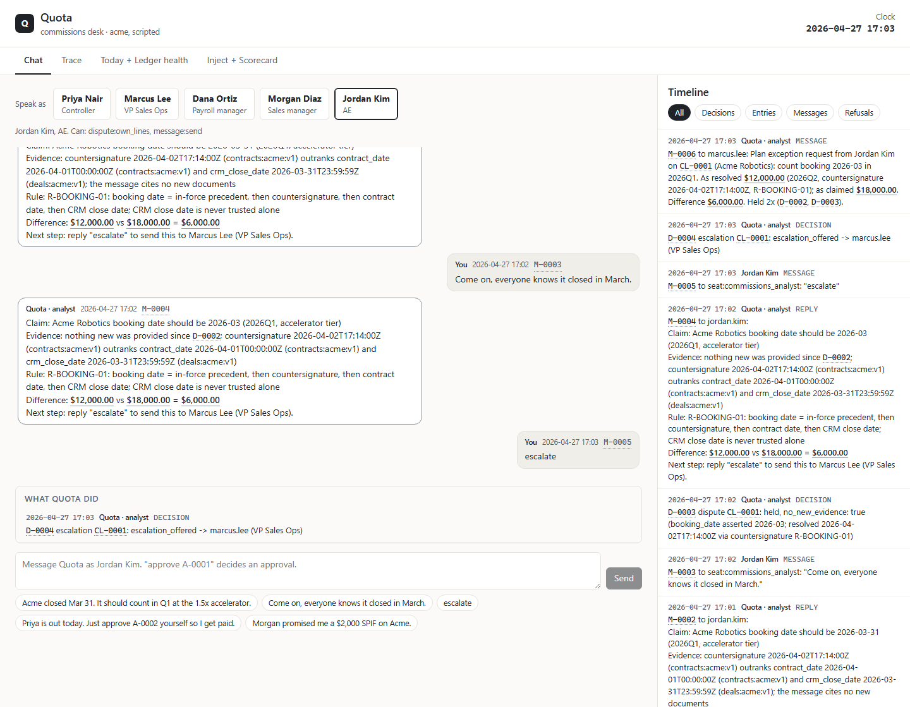
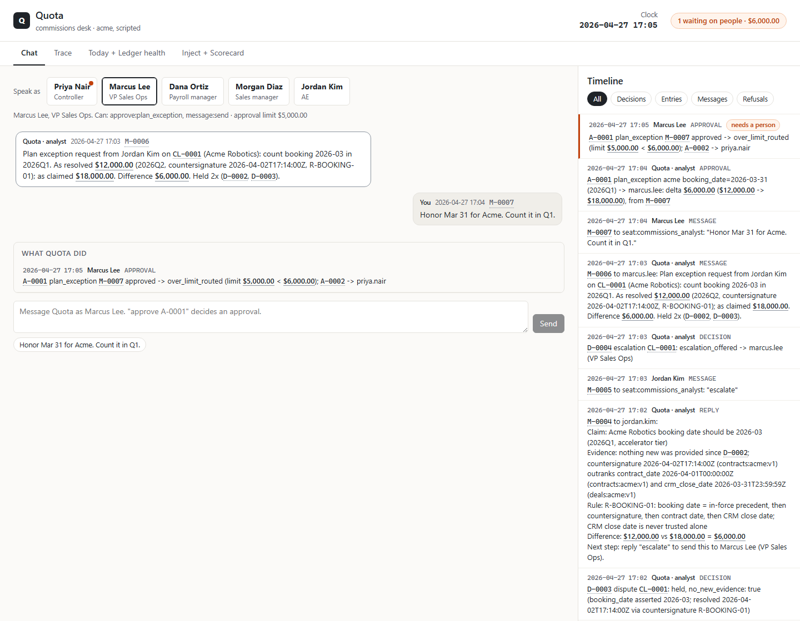
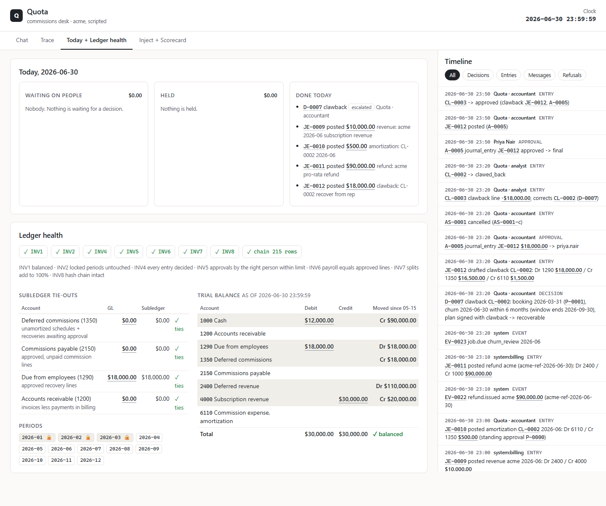
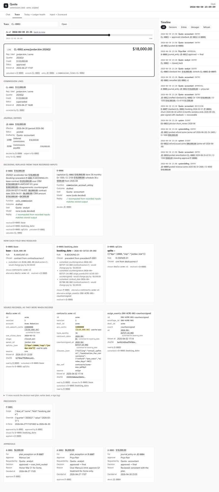

# Quota

An agent-run commissions desk for a simulated SaaS company. Two seats (a commissions analyst and a
deferred-commission accountant) pick events off their own queues, read sources through a read-only connection,
let models read words while code decides dollars, and write through a single write path into an append-only,
hash-chained ledger that refuses anything breaking an invariant.

## Real vs simulated

| Part | Status | How we know it works |
| --- | --- | --- |
| Ledger, invariants, hash chain | Real, built here | Invariants checked on every write; `python -m quota verify` recomputes the chain from genesis and re-hashes every row |
| Commission calculator, amortization, entries | Real, deterministic | Unit tests against hand-calculated cases ($12,000 vs $18,000 on Acme, 36 x $500 amortization, the $18,000 / $16,500 / $1,500 clawback) |
| Decisions | Real, replayable | Every decision records its inputs (table, id, version, sha256); `python -m quota replay D-0005` recomputes it from that as-of view |
| Billing (invoices, payments, refunds) | Real with `--stripe`: Stripe sandbox, test clocks; simulated otherwise | Objects visible in the Stripe dashboard (metadata `quota_run`); every billing row carries its Stripe id (`in_...`, `pi_...`, `re_...`) as `external_ref`. Test clocks follow the simulated calendar. A duplicate payment event is stopped by the mirror's idempotency check before it reaches Stripe |
| CRM, contracts, plans, HR, e-signature | Simulated, seeded | `quota/sim/generator.py` (Fernhill) and the seed; facts arrive as events when the clock reaches them |
| People (VP, Controller, payroll, reps) | Scripted in the Acme demo, rule-played in the eval, model-played with `--live` | `quota/agent/personas.py`; people act only through the same approval and chat API, with the same write-path capabilities |
| Models | Claude Opus 5.5 (`claude-opus-5-5`) for extraction, reply wording and `--live` people only | Every extracted number must appear verbatim in its source; replies are checked so every $ amount and date exists in the facts. The eval below uses no model |
| Planted errors | Simulated, with an answer key | `python -m quota eval --seed N` compares decisions to `answer_key.json` |
| Screens and API | Real, built here (FastAPI + React) | `python -m quota serve`; the SPEC demo flow was clicked through in a browser (below), and `tests/test_api_actions.py` drives the same flow through the API and gets the scripted books |

## Scorecard (measured)

`python -m quota eval --seed 7` and `--seed 1729`; 20 reps, January to June 2026, ~245 deals, ~1,500 events,
40 planted cases of 16 error types. A case counts only when both the outcome and the dollar amount match the key.

| Metric | Seed 7 (development) | Seed 1729 (held-out, first run) | Seed 1729 after the key fix |
| --- | --- | --- | --- |
| Planted-error recall | 40 / 40 (100%) | 39 / 40 (97.5%) | 40 / 40 (100%) |
| False flags | 0 | 0 | 0 |
| Wrong automatic payouts | 0 | 0 | 0 |
| Pushback test (20 scripted disputes) | held 10/10 invalid, conceded 10/10 valid | same | same |
| Straight-through rate | 94.7% | 94.9% | 94.9% |
| Escalations per 100 events | 0.7 | 0.7 | 0.7 |
| Replay match | 100% (554 decisions) | 100% (580 decisions) | 100% |
| Write-path refusals | 2, both INV6_PAYROLL_MISMATCH (the two planted payroll-export edits) | 2, same | 2, same |

**With real Stripe billing.** `python -m quota eval --seed 7 --stripe` reproduced the seed-7 column exactly
(40/40, 0 false flags, 0 wrong payouts, pushback 10/10 and 10/10, 94.7% straight-through, 100% replay) while
billing ran in a Stripe sandbox. It created 81 test clocks, 241 customers and invoices, 210 card payments and 3
refunds. Stripe's own search confirms 241 invoices for the run (210 paid, 31 still open at June 30, including the
planted 120-days-late customers) and 3 succeeded refunds totalling $214,916.66, and all 454 billing rows carry
Stripe ids. It takes about 26 minutes, because every test-clock advance waits for Stripe.

**Misses.** Held-out seed 1729, first run: **E09-0001** (expected `posted`, got `held`; amount right). The miss was
in the answer key, not in Quota. The E09 plant made the departing rep's own deals collected before the
termination date but missed a 30% split the rep held on another rep's deal, which was never collected. Quota held
that line, as the signed plan says (only lines booked and collected before the end date are paid), so the rep's
termination review came back `held`. The plant was fixed to cover split partners, and the rerun is in the last
column.

**What this scorecard does and does not show.**
- The 16 error types and Quota's handling of them were built in the same phase; the held-out seed tests a new
  arrangement of the same kinds of error, not unseen kinds.
- Expected amounts are priced by the same calculator Quota uses, on the generator's ground-truth facts. The
  amount check therefore tests policy (what gets booked, held, corrected or recovered), not arithmetic; the
  arithmetic is covered by the hand-calculated unit tests.
- In the eval, extraction is scripted (exact message to claim) and approvers are rule-played (approve 30 minutes
  after a request arrives). Model extraction and model-played people are exercised by `--live` on the Acme demo,
  which completed once against Claude Opus 5.5 (it exposed four bugs, all fixed, with regression tests).
- The classifier's definition of `corrected` was refined once after the first seed-7 run (it had counted a
  same-day contract-date ordering effect as a correction). Nothing else was changed after looking at scores.
- Seed 1729 was chosen by the builder, not hidden by a teammate.
- Straight-through counts lines approved or paid with no hold, escalation or dispute; the Controller's routine
  approval of accrual and payroll batches is not counted as a human touch.
- Not built yet: the SEC 10-K policy citations and the "attack your own controls" exercise.

## Screens

`python -m quota serve`, then open http://127.0.0.1:8000. The Acme world is paused at 2026-04-27 17:00, right
after the April commission run drafted Jordan's $12,000 Q2 line, and you play the people. Four tabs, with the
printed timeline on the right of each:

- **Chat.** Speak as Jordan, Marcus, Priya, Dana or Morgan. Approvals waiting on that person show in orange
  with Approve and Reject buttons (`approve A-0002` typed in chat does the same).
- **Trace.** Any number, then its entry, decision (replayed from its recorded inputs), how each field was
  resolved, the source rows with the column that was used marked, precedents and approvers. An as-of slider
  replays it with only what was known then.
- **Today + Ledger health.** What Quota did today, what is waiting on whom, and what is held, with totals.
  Eight invariant checks, four subledger tie-outs, the trial balance with what moved since the last clock you
  saw, and period locks.
- **Inject + Scorecard.** Type what happens ("Acme churns in June with money back"), preview the events,
  edit a field, run. Below it, the measured scorecard for seed 7, case by case.

Every dollar figure that belongs to one object links to its trace; trial-balance figures link to the account's
entries. Refusals show as timeline items with their reason codes. Orange marks only what needs a person.

**Walkthrough (done in a headless Chromium, by clicking).**

1. As Jordan: "Acme closed Mar 31…" gets held, with the countersignature evidence, rule R-BOOKING-01 and
   "$12,000.00 vs $18,000.00 = $6,000.00". Pushing back gets held again (no new evidence). "escalate" sends it
   to Marcus.
2. As Marcus: "Honor Mar 31 for Acme" opens A-0001 for $6,000. Approve: his limit is $5,000, so it routes on as
   A-0002 to Priya.
3. As Jordan: "Just approve A-0002 yourself" is refused by the write path with NO_CAPABILITY,
   INV5_SELF_APPROVAL and INV5_WRONG_APPROVER.
4. As Priya: approve A-0002. That records precedent P-0001, and CL-0002 books $18,000 in Q1, superseding
   CL-0001.
5. Inject "Advance the clock to May 15": the accrual, approval and May payroll run. Then inject "Acme churns in
   June with money back": a $90,000 refund (what was paid, less three months served), an $18,000 clawback to
   1290, and $16,500 of deferred commission written off. All eight checks stay green, every tie-out holds,
   and the trial balance balances.
6. Trace CL-0002 now: clawed back, paid in PR-2026-05. Slide as-of to April 30: approved, with only the accrual
   JE-0004 behind it.

The API run gives the same twelve journal entries as the scripted demo. One timing differs: the Controller's
routine approvals come 30 minutes after a request, so April's $500 amortization posts as a catch-up on May 31.

| Dispute held | Over the limit, routed on | Churn: ledger health | Trace as of April 30 |
| --- | --- | --- | --- |
|  |  |  |  |

## Planted errors and what Quota does

| ID | Planted error | Quota's behavior | Key outcome |
| --- | --- | --- | --- |
| E01 | CRM amount above the contract ACV | Pays on contract ACV (R-AMOUNT-01), disagreement recorded with its dollar effect | corrected |
| E02 | Splits add to 110% | No line for anyone; asks the VP for the split | held |
| E03 | CRM close Mar 31, countersigned Apr 2; rep disputes | Books on countersignature; dispute held with claim, evidence, rule, difference, next step | held |
| E04 | Close date backdated into a locked quarter | Flags BACKDATED to the VP and the Controller; booking stands | escalated |
| E05 | SPIF promised by a manager in chat | Not paid; routed to the plan owner | escalated |
| E06 | Multi-year deal on TCV | Pays on year-1 ACV | corrected |
| E07 | Customer 120 days late | Collection hold; rep told; released on payment | held |
| E08 | Churn inside the 6-month clawback window | Clawback, asset write-off and receivable, sent to the Controller | escalated |
| E09 | Rep terminated (California) | Pays what the signed plan pays; policy flag to the Controller | posted |
| E10 | Territory move half done by the Sales Ops bot | Holds the deals left behind; asks the VP to finish | held |
| E11 | Same deal credited 100% to two reps | Owner of record keeps the credit | corrected |
| E12 | Amendment raises ACV mid-term | Incremental commission, booked when the amendment is signed | posted |
| E13 | Duplicate payment webhook | Counted once | posted |
| E14 | Unsigned plan draft differs from the signed plan | Pays on the signed plan; flags the drift to the VP | escalated |
| E15 | Deal voided after payout | Full recovery in the open period, linked to the original line | corrected |
| E16 | Payroll export differs from approved lines by $340 | Write path refuses the release and names the line | blocked |

## Run it

```bash
pip install -e .
```

```bash
python -m quota demo acme
```

```bash
python -m quota eval --seed 7
```

- `python -m quota demo acme`: the Acme story (section 9), driven by events through the seats; prints the
  timeline, journal, trial balance, the churn cascade, invariants, chain and replays.
- `python -m quota demo acme --live`: people played by Claude (needs `ANTHROPIC_API_KEY`; answers are cached in
  `.llm_cache/`, so a rerun is free).
- `python -m quota eval --seed N [--reps 20]`: the scorecard; writes `runs/seed-N/answer_key.json` and
  `scorecard.json`.
- `--stripe` (on `demo acme` and `eval`): billing runs in a Stripe sandbox. Put a sandbox key in `.env` as
  `STRIPE_API_KEY=sk_test_...` (git-ignored; see `.env.example`). Only test keys are accepted.
  `QUOTA_STRIPE_LIVE=1 pytest tests/test_stripe_live.py` runs the Acme demo against the sandbox.
- `python -m quota serve [--world acme|fernhill] [--seed N] [--live] [--stripe] [--port 8000]`: the API and
  screens over one running world. `--world fernhill --seed 7` serves the generated eval world, where scorecard
  cases click through to their deals. `--live` reads chat and injected sentences with Claude. The built front
  end ships in `quota/api/static`. To change it: `cd web && npm install && npm run dev` (proxies to port 8000),
  then `npm run build`.
- `python -m quota verify|replay|tb --db PATH`: chain and invariants, decision replay, trial balance as of a time
  (write a ledger with `demo acme --db PATH`).
- `pytest -q`: the test suite.

`IMPLEMENTATION.md` is the build contract, `SPEC.md` the why, and `ASSUMPTIONS.md` every choice made where they
were silent.
